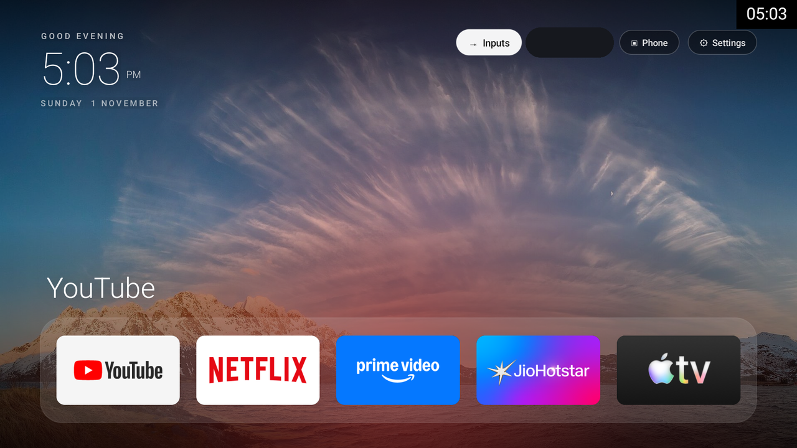
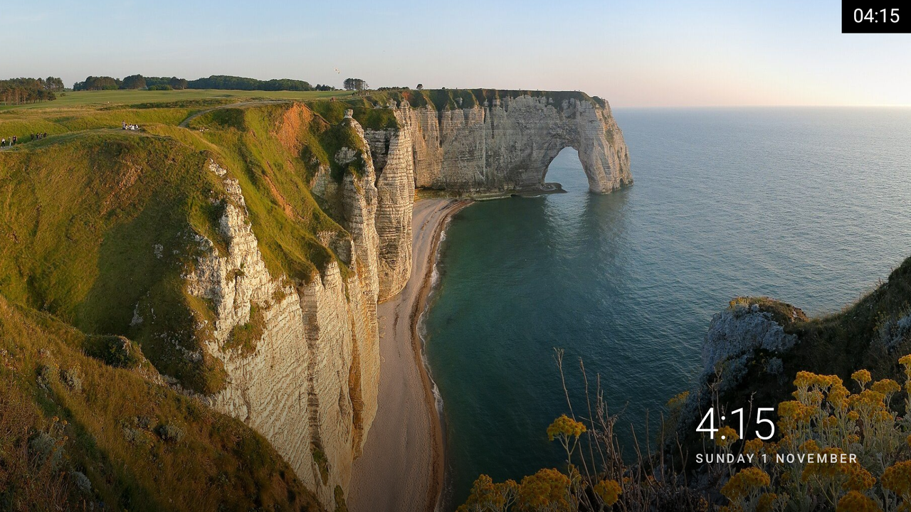
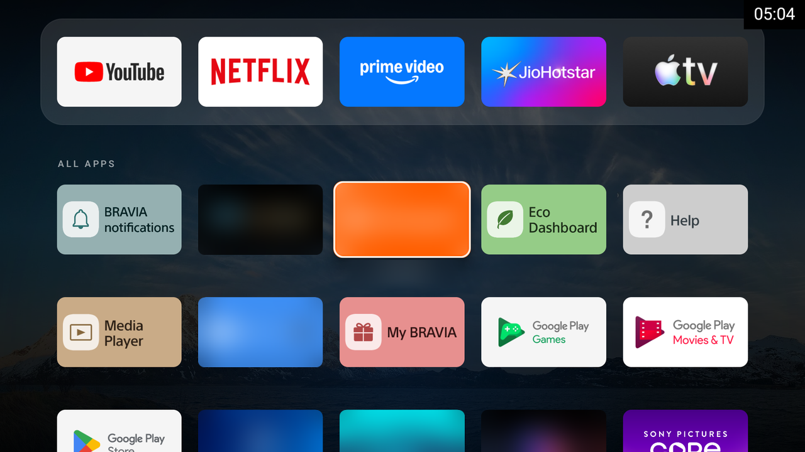
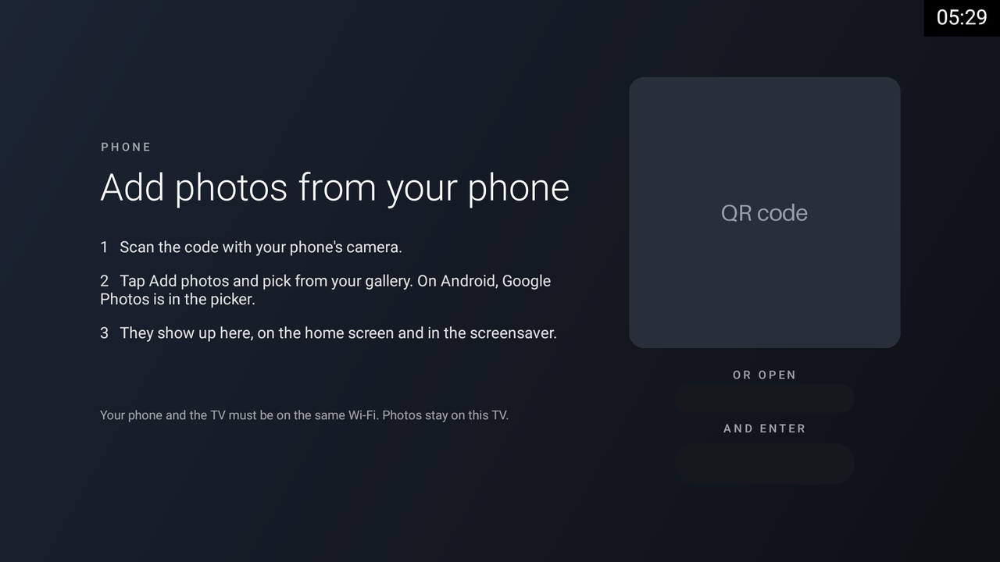

# Canvas: a clean, ad-free home screen and photo frame for Android TV and Google TV

**Canvas replaces your Android TV or Google TV home screen with a clean, ad-free one, and turns the TV into a photo frame when nobody is watching.** Add photos from your phone over Wi-Fi. No account, no cloud: everything stays on your TV. A business mode that turns an idle TV into free digital signage for shops and clinics is next.

Status: early. It has been tested on one TV so far (see [Tested on](#tested-on)). Installing it changes your TV's home app, and it is reversible, so read [Install](#install) first.



| Screensaver | All apps | Add photos from your phone |
|---|---|---|
|  |  |  |

The Phone screen is shown with its QR code, address and PIN blacked out. The screensaver shot uses one of the built-in photos.

## What you get

- **A clean home screen.** A dock of your favourite apps, every other app one press below, a clock, and your Inputs (HDMI, Live TV) one click away. No ads, no "sponsored" rows, no autoplaying trailers. It is built from plain Android views (no web view, no UI framework). Its start-up time and memory use have not been measured yet; for reference, Google TV's own launcher used about 88 MB of memory while idle on the test TV.
- **A photo-frame screensaver.** Your photos with a slow pan and zoom, soft crossfades, two portrait photos side by side, and a caption like "March 2023 · 3 years ago". Left and Right on the remote flip photos.
- **Photos from your phone.** Press **Phone** on the home screen, scan the QR code, tap **Add photos**. Your phone's own photo picker opens, so there is nothing to sign in to.
- **Edit from your phone or the TV.** Reorder the dock, hide apps, change how long each photo stays up. On the TV, hold OK on any app.
- **Reversible.** Install backs up the TV's settings first and uninstalls nothing. `tools/canvas restore` switches the TV's own home app back on, puts the previous home screen and screensaver back, takes back the permissions install gave Canvas, stops it, and reads the TV to check that it all took.

## Install

You need a computer on the same Wi-Fi as the TV. The tools are Python 3 and a shell script; they were developed on macOS, Linux should work, and Windows is untested (try WSL). You do not need `adb` or Android Studio: the tools speak ADB over Wi-Fi themselves.

**1. Turn on USB debugging on the TV.** Open the TV's **Settings**, go to **System → About** (the menu names differ between TVs), and press OK on **Build** (or **Android TV OS build**) 7 times. That unlocks **Developer options**, which now appears under **System**. Open it and switch **USB debugging** on. If your TV also has a "Network debugging" or "ADB over network" switch, turn that on too.

**2. Get the tools and the APK.** Clone this repository, which holds the `tools/canvas` command:

```bash
git clone https://github.com/shalintripathi/android-tv-canvas && cd android-tv-canvas
```

Then get the Canvas APK in one of two ways:

- download `canvas-<version>.apk` from the [Releases page](https://github.com/shalintripathi/android-tv-canvas/releases) in your browser; or
- with the [GitHub command line tool](https://cli.github.com/): `gh release download --pattern 'canvas-*.apk' -D build`

**3. Find the TV.**

```bash
tools/canvas find
```

It scans your Wi-Fi for a device with ADB open and remembers it. The first run also sets up a small Python environment, which needs internet once. If it finds nothing, check step 1 and that the computer and the TV are on the same network.

**4. Install Canvas.**

```bash
tools/canvas install build/canvas-*.apk      # or the path of the APK you downloaded
```

Accept "Allow USB debugging?" on the TV when it asks. `install` then:

1. backs up the TV's home screen, screensaver and sleep settings to `tools/backups/` on your computer;
2. installs Canvas;
3. asks the TV which home apps it has, and stops before switching anything off if Canvas is not one of the choices;
4. **lists the TV's own home apps and asks you first**: `Disable these and make Canvas the home screen? [y/N]`. The default is No. If you answer No (or press Enter, Ctrl-C or Ctrl-D), Canvas stays installed without the location or settings permissions, and nothing else on the TV changes. `--yes` skips the question. The list never includes Canvas, the system Settings apps, or any app that provides the system's FallbackHome safety net;
5. after a yes, grants Canvas the two permissions it needs to change the screensaver and sleep settings (see [Privacy & security](#privacy--security)), and stops if the TV refuses, then the location permission Android requires before it tells an app the Wi-Fi network's name;
6. switches those apps off (each one is written to the backup before it is touched) and makes Canvas the home app;
7. checks that Canvas really became the home screen. If it did not, it switches those apps back on, takes the permissions back and says so;
8. only then sets the Canvas screensaver.

If install stops part-way (the Wi-Fi drops, say), it says so, and `tools/canvas restore` undoes whatever it had done. `--app-only` installs or updates the app alone and grants nothing.

Press Home on the remote when it finishes.

**Undo everything:** `tools/canvas restore --uninstall`. This also uninstalls Canvas, which deletes the photos added from phones; plain `tools/canvas restore` puts the TV back but keeps the app and its photos.

**Using Claude Code?** Open it in this folder and say: *"Install Canvas on my TV and make it the home screen."* It can follow these steps with `tools/canvas`. Because `install` asks before it switches off the TV's own home app, Claude Code is instructed (see [AGENTS.md](AGENTS.md)) to show you that list and ask first, and only then run it again with `--yes`.

### Remove preinstalled apps (you choose)

Optional. Many TVs ship with promo apps, shop-demo modes and trial apps that you may never use. Canvas can switch off the ones you pick, and only those:

```bash
tools/canvas debloat devices/google-tv-common.txt     # Google's own extras; should be safe on Google TV, untested beyond the Sony BRAVIA
tools/canvas debloat devices/sony-bravia-bf1.txt      # the list for the tested Sony BRAVIA
```

A device list groups apps ("Sony promos", "Google extras", ...). `debloat` shows each group with a plain-words explanation of every app in it and asks `Disable this group? [y/N]`. The default is No: press Enter and the group is left alone. `--group "<name>"` applies one group without questions, and `--yes` applies them all.

Nothing is uninstalled. Apps are only switched off for the main user, and `tools/canvas undebloat <list>` switches them back on (it asks the same way). Lists are plain text, and you can write one for your own TV: see [devices/README.md](devices/README.md) for the format, how to find package names, and what must never go in a list.

## Tested on

| TV | Android | Status |
|---|---|---|
| Sony BRAVIA (BF1) | 12, Google TV | Home screen, screensaver and phone page work, with photos added from an iPhone. `install` was exercised on it with an earlier version that switched off Google TV's two home apps by name; the generic home-app detection that replaced it is new and so far tested offline only. `restore` has only been tested offline and has not yet run on a TV. `debloat` has been applied for the "Sony promos" group only. |

Not yet checked on a TV: `restore`, the generic home-app detection and the new question in `install`, the phone page's local-network checks, Canvas's start-up time and memory use, whether the remote's voice button still behaves as before once the TV's own home app is off, the Left and Right keys during the screensaver, the screensaver staying away while a video plays, and adding photos from an Android phone.

**Expected to work, but untested.** Canvas needs Android 7.0 (API 24) or newer. These should work:

- TVs with Android TV or Google TV: other Sony BRAVIA models, TCL, Hisense, Philips, Xiaomi / Mi TV, OnePlus and similar.
- Streamers and boxes: Chromecast with Google TV, Google TV Streamer, Nvidia Shield, Xiaomi Mi Box.

Some makers lock their launcher so it cannot be switched off. In that case `tools/canvas install` notices that Canvas did not become the home screen, switches the TV's own home app back on, and stops.

**Add your TV.** Run `tools/canvas probe` and open an issue with what it prints, and say what worked and what did not. The first line `tools/canvas` prints, "Connecting to ...", contains your TV's address: leave that line out. Device lists for other TVs are welcome too (see [devices/README.md](devices/README.md)).

## FAQ

**How do I remove ads from the Android TV or Google TV home screen?**
The ads and sponsored rows are part of the TV's own launcher: Google's launcher on Google TV (`com.google.android.apps.tv.launcherx`), or the maker's launcher on other Android TVs. Canvas replaces whichever one your TV has. `tools/canvas install` finds the TV's home apps, lists them and asks you, then switches them off (reversibly, with a backup) and makes Canvas the home app. Your installed apps stay installed. Install only switches off packages that offer themselves as a home screen, not the Play Store or voice search, but whether the remote's voice button still behaves as before has not been checked yet.

**Does it work on my TV?**
It is tested on one TV, a Sony BRAVIA running Google TV. Other Android TV and Google TV devices are expected to work. See [Tested on](#tested-on), and please tell us how it goes on yours.

**Does it work on Fire TV / Samsung / LG?**
Samsung TVs (Tizen), LG TVs (webOS), Roku and VIDAA TVs do not run Android apps, so Canvas cannot be installed on them. A Google TV Streamer, Chromecast with Google TV or other Android TV box plugged into their HDMI port should work. Amazon Fire TV is based on Android, so the app may install, but Amazon is understood to block replacing the home screen and the screensaver there, so the main features are not expected to work. This is untested.

**Can Android TV show my Google Photos as a screensaver?**
Not as a live album. Since March 2025 Google no longer lets other apps read your Google Photos library, so Canvas works differently: you pick photos on your phone, and Canvas copies them to the TV and shows them in its screensaver. On Android, Google Photos is one of the places the phone's photo picker offers (not tested yet; an iPhone has been). If you want albums that update by themselves, use Google's own Ambient mode: `tools/canvas restore` brings it back.

**Can I use my TV as free digital signage for my shop or clinic?**
That is Canvas's next milestone: offers, menus, QR codes (UPI, Google reviews), a clinic token display and business hours, managed from your phone, on the TV you already own, without a player box or a monthly fee. Watch or star the repo to follow it.

**Is it safe? Does it send my photos anywhere?**
No. Canvas has no account and no cloud, and your photos stay on the TV. The details, including what the phone page does and does not protect, are in [Privacy & security](#privacy--security).

**Why is there a `debug.keystore` in the repo?**
It is Android's standard throwaway debug signing key, with the public password "android" that every Android developer's debug key has. It is committed on purpose, so that debug builds from CI are signed with the same key every time and update in place on your TV. It protects nothing. The release builds you download from the Releases page are signed with a private key that is never in the repo.

## Privacy & security

- **No account, no cloud.** Canvas does not sign in to anything and does not send your photos, settings or usage anywhere. Photos are stored on the TV.
- **The phone page is served by the TV.** Whenever Canvas is running (as the home screen, that is practically always while the TV is on), the TV serves a small web page on port 8765, over plain HTTP (not HTTPS). It answers only devices on your local network, and only when they open it by the TV's address, as the QR code does. Only use it on a network you trust, not on public or shared Wi-Fi. A device that has not been paired sees only the page asking for a PIN.
- **Pairing is by QR code or PIN.** The code on the TV expires after 10 minutes, and 5 wrong PINs void it. After 10 wrong PINs within 10 minutes, even across new codes, the TV stops accepting PINs for up to 10 minutes; the QR code still works. A paired phone gets a long random session value; the TV stores only its SHA-256 hash. You can see paired phones, and remove them, from the phone page.
- **State-changing requests need two things:** the pairing cookie and a custom `X-Canvas` header. A web page you happen to open on your phone cannot send that header to the TV, so it cannot add or delete photos or change settings behind your back.
- **Canvas never needs your Wi-Fi password.** It asks for the network permission to run the phone page, and for the location permission Android requires before it lets an app read the Wi-Fi network's name, which Canvas shows in the header. `tools/canvas install` grants location only after you answer yes, like the two settings permissions below. It does not use your location.
- **Two powerful permissions, granted by `tools/canvas install`.** `WRITE_SECURE_SETTINGS` lets an app write to the TV's system-wide Secure settings, which is far more than Canvas needs. Canvas uses it only for the screensaver and sleep settings (`screensaver_components`, `screensaver_enabled`, `screensaver_activate_on_sleep` and `sleep_timeout`). `WRITE_SETTINGS`, granted through `appops`, lets an app write the System settings; Canvas uses it only for the screen-off timeout (`screen_off_timeout`). The grants are on the Canvas package alone, are made only after you answer yes in `install`, and go away when you run `tools/canvas restore` or uninstall Canvas.
- **Install and debloat are reversible.** Install keeps a backup in `tools/backups/` on your computer. `tools/canvas restore` undoes install, including taking back the permissions and stopping Canvas, and `tools/canvas undebloat <list>` undoes debloat. Nothing is ever uninstalled except by `restore --uninstall`, which removes Canvas itself.

## Compared with

| | Canvas | Google TV home | Projectivy Launcher | FLauncher | Yodeck (signage) |
|---|---|---|---|---|---|
| Ads on the home screen | None | Sponsored rows | None | None | n/a |
| Photo-frame screensaver from your phone | Yes | Ambient mode (Google Photos) | No | No | n/a |
| Open source | Yes (MIT) | No | No | Yes | No |
| Digital signage | Next milestone | No | No | No | Paid, per screen |
| Needs an account | No | Google | No | No | Yes |

## Roadmap

- **Milestone 2:** USB photos, art mode (public-domain paintings from the Met and the Art Institute of Chicago), night mode, weather, "on this day", Immich and Nextcloud.
- **Milestone 3, business mode:** playlists of images, videos and PDFs; offer and menu templates; logo, ticker and QR overlays; business hours.
- **Milestone 4:** clinic token display, Google Drive and Sheets sources, managing many screens.

The full design is in [docs/specs/2026-11-01-canvas-design.md](docs/specs/2026-11-01-canvas-design.md).

## Build it yourself

Every push builds a debug APK in GitHub Actions. To use one: `tools/fetch-ci-apk.sh` (needs the `gh` command line tool), then `tools/canvas install build/ci/app-debug.apk`. Locally, with JDK 17 and the Android SDK: `./gradlew test assembleDebug`. The tests for the tools need no TV: `tools/venv/bin/python -I -m unittest discover -s tools -p 'test_canvas.py'` (the `venv` folder appears the first time you run `tools/canvas`).

A debug build and a release build are signed with different keys, so Android will not update one with the other. To switch, run `tools/canvas restore --uninstall`, then `tools/canvas install <apk>` with the other build. Uninstalling deletes the photos added from phones.

## Credits

Canvas started from [mihirgupta0900/tv-home](https://github.com/mihirgupta0900/tv-home) (MIT), which also supplied the built-in wallpapers (Wikimedia Commons, CC BY-SA; see [WALLPAPER-CREDITS.md](WALLPAPER-CREDITS.md)). Code is MIT, see [LICENSE](LICENSE).

QR codes: [ZXing](https://github.com/zxing/zxing) (Apache-2.0).
